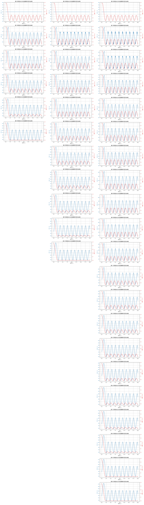
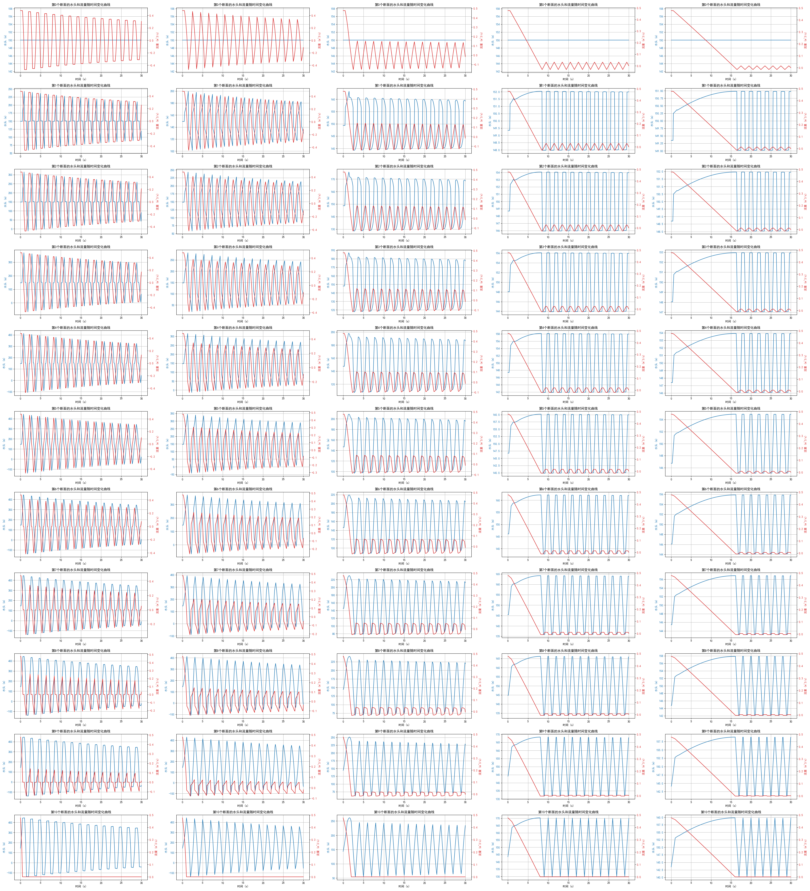
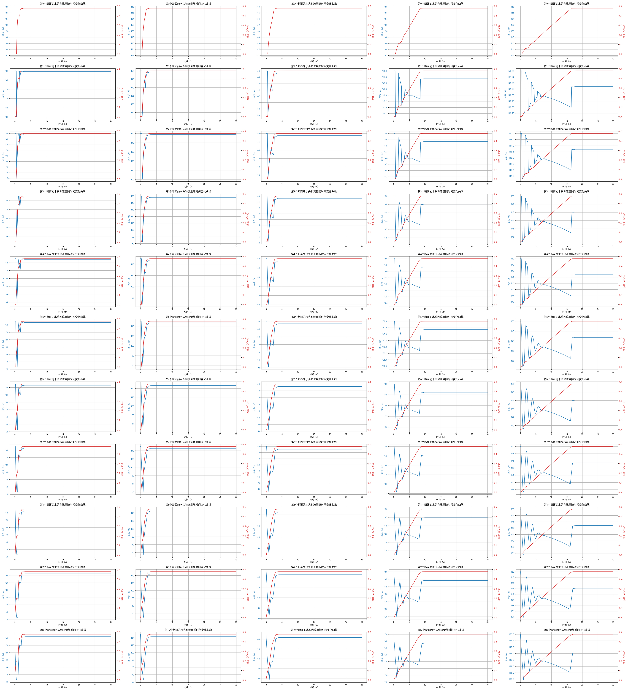
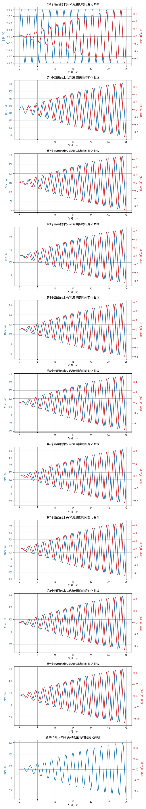
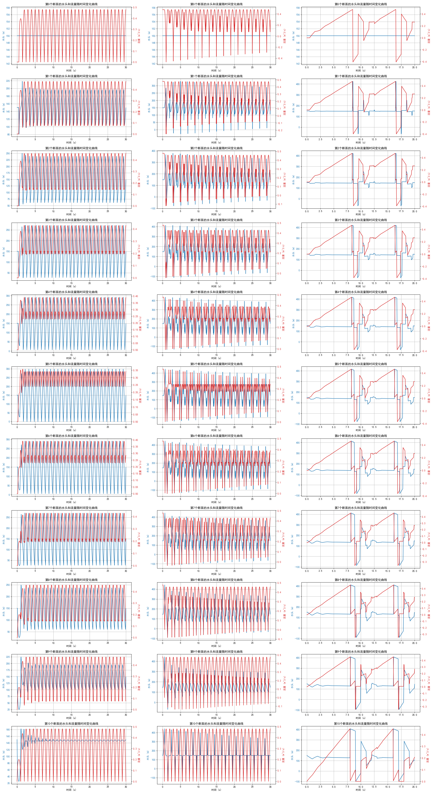
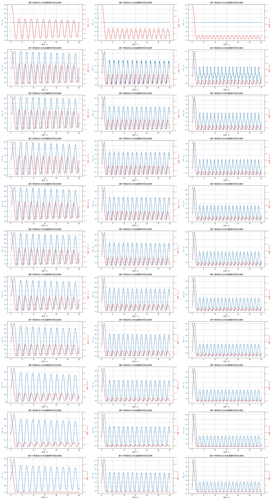
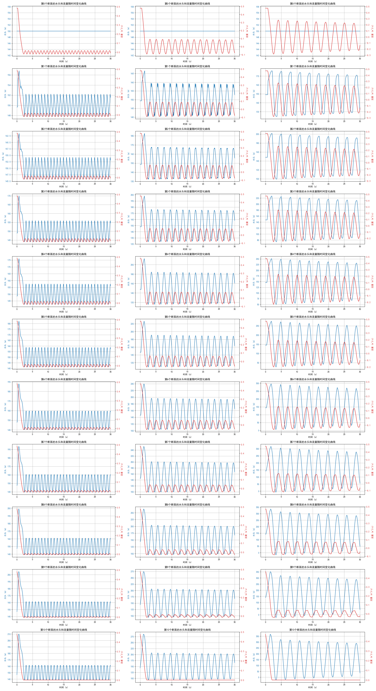
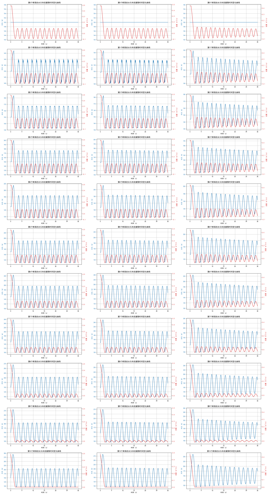

## 单管管道瞬变流作业

### 第一题

稳定流动，管内各截面处流量和速度保持恒定，则

$$
\frac{\partial{v}}{\partial{x}}=0,\ \ \ \frac{\partial{v}}{\partial{t}}=0
$$

运动方程变形为

$$
\frac{\partial{H}}{\partial{x}}+\frac{fv^2}{2Dg}=0
$$

对$x$积分有

$$
\Delta{H}=\frac{fv^2l}{2Dg}
$$

联立

$$
Q_0=\frac{\pi D^2v}{4}
$$

$$
Q_0=(C_dA_g)_0\sqrt{2gH_0}
$$

解得管道中水流流量

$$
Q_0=0.4774\ \mathrm{m^3/s}
$$

$$
H_0=143.5\ \mathrm{m}
$$

### 第二题

编程分别计算N=5,10,20时的管道中压力和流量变化情况，将每个N值时各个节点的结果作为一列，绘图如下：

各个节点的压力和流量变化是连续的，并且趋势一致。由于波速很快，各个节点处的波峰波谷出现的时间基本是一致的。

### 第三题

分别计算$t_c=0.5s,1.0s,2.0s,8.0s,16s$时的管道中压力和流量变化情况，将每个$t_c$值时各个节点的结果作为一列，绘图如下：

随着阀门关闭时间的逐渐增大，各个节点处压力和流量波动的振幅都不断降低。可见，缓慢关闭阀门可以有效减少水锤效应对管道造成的影响。

### 第四题

分别计算$t_s=0.5s,1.0s,2.0s,8.0s,16s$时的管道中压力和流量变化情况，将每个$t_s$值时各个节点的结果作为一列，绘图如下：

随着阀门开启时间的逐渐增大，各个节点处压力的波动次数不断增加，但振幅逐渐下降。流量在不同情况下都基本不产生波动，但流量达到最大所需的时间逐渐增大，和阀门开启的时间保持一致。

### 第五题

假设阀门关闭，水库表面有系列正弦波经过，将各个节点的压力和流量变化情况绘图如下：

同一时刻，从上游到下游各节点压力和流量波动的振幅越来越大；同一节点，随着时间变化，压力和流量波动的振幅也越来越大。可见，水库表面正弦波对管道造成的影响具有累积效应，随着时间和距离不断积累，在阀门处造成的影响最大。

### 第六题

分析阀门周期性动作规律时，管道中压力和流量变化情况。将各个节点的压力和流量变化情况绘图如下,其中第一列为

$$
\tau = |\sin{\pi t}|
$$

第二列为

$$
\tau =|\cos{\pi t}|
$$

第三列为

$$ \tau=\left\{
\begin{array}{rcl}
t/t_c && {0\leq t\leq t_c}\\
1-t/t_c && {t_c \leq t \leq 2t_c}\\
…
\end{array} \right. 
$$

### 第七题

初始阀门开启，改变波速，分别计算$a=900m/s,1200m/s,1500m/s$时的管道中压力和流量变化情况，将每个$a$值时各个节点的结果作为一列，绘图如下：

随着波速增大，各节点压力和流量波动的振幅减小，周期也减小。

改变管道长度，分别计算$l=300m,600m,900m$时的管道中压力和流量变化情况，将每个$l$值时各个节点的结果作为一列，绘图如下：

随着管道长度增大，各节点压力和流量波动的振幅增大，周期也增大。

改变摩阻系数，分别计算$f=0,0.018,0.1$时的管道中压力和流量变化情况，将每个$f$值时各个节点的结果作为一列，绘图如下：

随着摩阻系数增大，各节点压力和流量波动的振幅以更快的速度衰减。摩阻系数为0，即液体和管道之间无摩擦时，波动不衰减。
